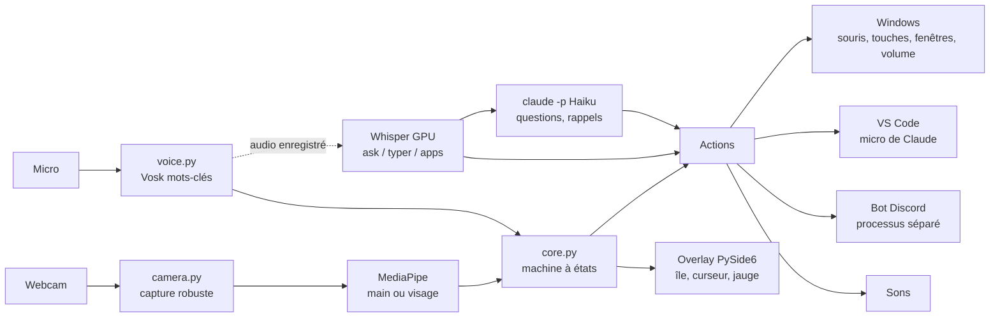

# 01 · Présentation

> **En bref**
> Iris (nom du projet : motionzero) contrôle Windows avec la webcam et la voix.
> Elle est faite pour quelqu'un qui n'a plus l'usage pratique de ses mains.
> Une Iris arrêtée bloque l'utilisateur : tout est pensé pour qu'elle reste debout.

## 🎯 Pour qui, pourquoi

- L'utilisateur travaille **avec** Iris toute la journée : lecture, navigation, code avec Claude Code, Discord.
- Le clavier n'est jamais nécessaire. Iris envoie elle-même les touches et les clics à Windows (`SendInput`).
- Tout tourne sur le PC, sauf les questions et rappels (Claude Haiku via `claude -p`) et le bot Discord.

## 🧩 Ce que fait Iris

| Domaine | Exemples |
|---|---|
| 🖐️ Gestes de la main | tourner les pages (paume au bord), défiler, souris type pavé tactile, clic main ouverte |
| 🙂 Tête | la souris suit l'orientation de la tête (« iris tête ») |
| 🎙️ Mots-clés | « iris clic », « iris entrée », « iris chrome », « stop »… (Vosk, hors ligne) |
| ✍️ Phrases libres | dictée « iris type », nom d'appli « iris ouvre », durée « iris timer » (Whisper, carte graphique) |
| 🤖 Claude | « iris question » (réponse affichée), « iris rappel » (rappels compris par Haiku), « iris claude » (micro de Claude dans VS Code) |
| 💬 Discord | couper le micro, message, salon vocal, lecture des messages (bot séparé) |
| 🪟 Fenêtres | plein écran, réduire, ancrer à gauche / droite, Alt+Tab |
| ⏰ Temps | rappels, alarmes, timer, chronomètre, calendrier, heure |

## 🖼️ Schéma d'ensemble

## 👀 Ce que l'on voit à l'écran

- **Fenêtre d'accueil** (« iris accueil ») : image de la caméra, aide, consommation du PC, bouton main / tête.
- **Verre** plein écran transparent aux clics : l'« île » en haut (dernière commande, réponses, rappels), le curseur, la main fantôme, la jauge de défilement, la barre de volume.
- **Bouton STOP** en bas à droite, **bouton œil** (masquer l'overlay dans les partages d'écran), **bouton de réparation du son** en bas à gauche.

> **Note** La voix sert à ce que la main ne fait pas bien. La main sert à viser, tourner les pages et défiler.

---
[← Sommaire](README.md) · [Sommaire](README.md) · [Utilisation →](02-utilisation.md)
