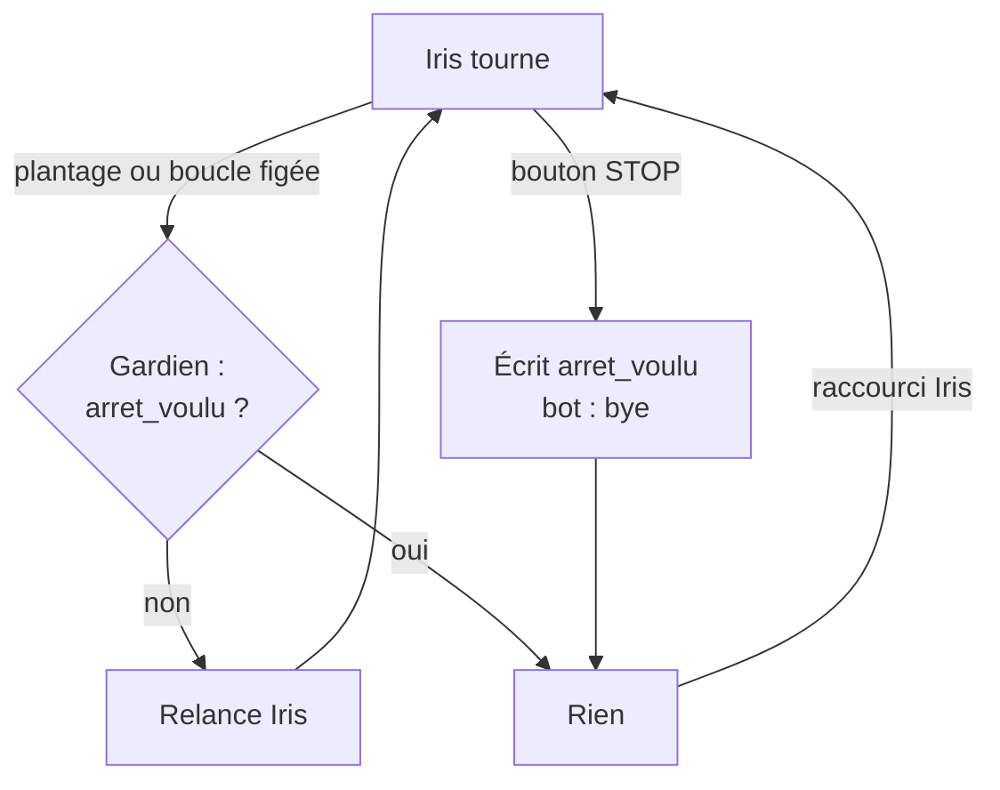
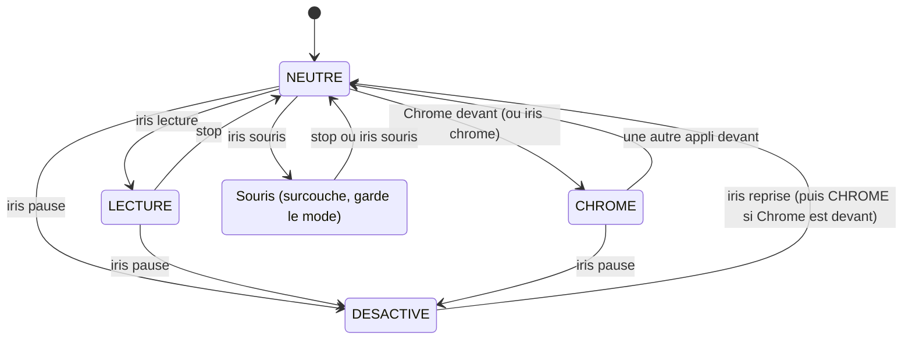

# 02 · Utilisation

> **En bref**
> Démarrer : raccourci « Iris » du bureau (ou démarrage de Windows, via le gardien).
> Arrêter : bouton STOP. Le gardien relance Iris après un plantage, jamais après un STOP.
> Au départ, Iris est en mode NEUTRE : la main ne fait rien, seule la voix agit.

## Démarrer

| Moyen | Ce qui se passe |
|---|---|
| Raccourci **« Iris »** du bureau | `tools/relancer.pyw` : tue l'Iris en cours (seulement `-m motionzero`, sans `/T`), efface `logs/arret_voulu`, lance Iris puis le gardien. |
| **Démarrage de Windows** | Raccourci « Iris (gardien) » du dossier Démarrage : `pythonw -m motionzero.garde --start`. |
| **Bot Discord** | Il relance Iris si elle se fige ou s'arrête sans dire « bye ». |
| Ligne de commande | `.venv/Scripts/python -m motionzero --voice` (`--simulation` : rien n'est envoyé à Windows). |

## Volume d'Iris

Le bouton **Volume d'Iris** de l'accueil règle les sons d'Iris seulement (pas le volume de Windows) : 30, 50, 70 puis 100 %. Un son est joué à chaque clic pour l'entendre. Choix gardé dans `volume_iris.txt`.

## Effets d'animation

Si les « Effets d'animation » sont coupés dans Windows (Accessibilité > Effets visuels), l'île ne cligne plus, l'heure apparaît sans animation et l'alarme reste rouge sans pulser. Le réglage est lu au démarrage d'Iris.

## Voix basse

De 22 h à 7 h, Iris accepte une voix plus faible : la vérification qui écarte les mots de conversation devient moins stricte, mais les phrases longues restent refusées. Le bouton **Voix basse** de l'accueil passe de « le soir » à « toujours » puis « jamais ».

## Arrêter

- **Bouton STOP** (en bas à droite) : un vrai clic seulement (souris, ou clic d'Iris en mode souris). Le survol ne l'active pas.
- STOP relâche tout, prévient le bot (`bye`) et écrit `logs/arret_voulu` : ni le gardien ni le bot ne relancent.
- Fermer le verre ou le bouton fait la même chose.
- Pour **relancer**, utiliser le raccourci « Iris » : il efface `arret_voulu`.

> **Note** « iris pause » n'arrête pas Iris : elle passe en mode DÉSACTIVÉ et reprend sur « iris ».

## Les modes

Le **mode** dit ce que fait la main. La **souris** n'est pas un mode : c'est un outil qui s'ajoute au mode en cours (on peut avoir Chrome + souris).

Le mode Chrome suit Chrome au premier plan (contrôlé toutes les 0,3 s), sans son à chaque Alt+Tab. Les fenêtres d'Iris (accueil, aide, fenêtre invisible des raccourcis Discord) ne comptent pas : « iris mute » ou « iris accueil » ne font plus quitter Chrome. « stop » ne quitte plus Chrome. La lecture, choisie à la voix, n'est pas remplacée par Chrome. Chaque changement de mode est noté dans le journal avec sa cause. La souris peut aussi s'allumer en LECTURE (bulle) ou en CHROME : le mode reste.

| Mode | La main… | Particularités |
|---|---|---|
| **NEUTRE** | ne fait rien | mode de départ (`start_mode`) |
| **LECTURE** | paume au bord droit / gauche = page suivante / précédente ; en haut / bas = défile ; immobile 1,5 s = bulle « SOURIS ? » (petit geste vers le haut pour confirmer) | « iris lecture » éteint la souris |
| **CHROME** | comme NEUTRE | mots de navigation sans « iris » (voir [commandes](03-commandes-vocales.md#mode-chrome)) ; actif tant que Chrome est au premier plan ; « iris chrome » le met devant (5 s pour s'ouvrir, sinon « CHROME INTROUVABLE ») |
| **DÉSACTIVÉ** | rien, MediaPipe arrêté | « iris » (et « stop ») réveille |

### La souris (surcouche)

- « iris souris » l'allume ou l'éteint. « stop » l'éteint sans changer de mode.
- Le curseur part du **centre**. Il attend que la main (ou la tête) passe au centre de l'image : c'est l'**armement**. Avant, une **main fantôme** montre où est la main.
- Main immobile 0,8 s : **menu à 4 directions** (gauche = clic gauche, droite = clic droit, haut = double clic, bas = souris éteinte).
- Clic par la main (si calibré, `calibration/poses.json`) : main fermée pour viser, rouverte = clic ; gardée ouverte plus de 2 s = bouton tenu.
- Pendant la souris : « clic », « double », « menu » marchent **sans « iris »**. Le clic vise là où était le curseur au début de la commande.

### Main ou tête

- « iris tête » / « iris main », ou le bouton de l'accueil. Le choix est gardé d'une session à l'autre (`pointeur.txt`).
- À la tête, seul le visage est détecté. « iris centre » : la tête de face devient le centre.

## Défilement

1. « iris défile ».
2. Amène la main au **centre** (bande horizontale) : la jauge à droite s'arme.
3. Monte la main : ça monte. Descends-la : ça descend. Plus loin du centre = plus vite.
4. Fin : « iris défile » redit, « stop », une autre commande, ou (à la main) main sortie de l'image.

En LECTURE, la main en haut / bas de l'image défile aussi, sans voix.

## Dictée

| Commande | Où va le texte | Fin | Ensuite |
|---|---|---|---|
| « iris type » | là où est le curseur, n'importe quelle appli (Whisper) | 2 s de silence | 3 s pour « envoie » (Entrée) ou « annule » (efface) |
| « iris claude » | micro de Claude dans VS Code | 2,75 s de silence | 30 s pour « envoie », « annule » ou « claude » (redicter) |
| « recherche » (mode Chrome) | barre d'adresse | comme « type » | idem |

Rien dit pendant 8 s : la dictée est abandonnée. Pendant une dictée, les mots ne sont **pas** des commandes.

---
[← Présentation](01-presentation.md) · [Sommaire](README.md) · [Commandes vocales →](03-commandes-vocales.md)
