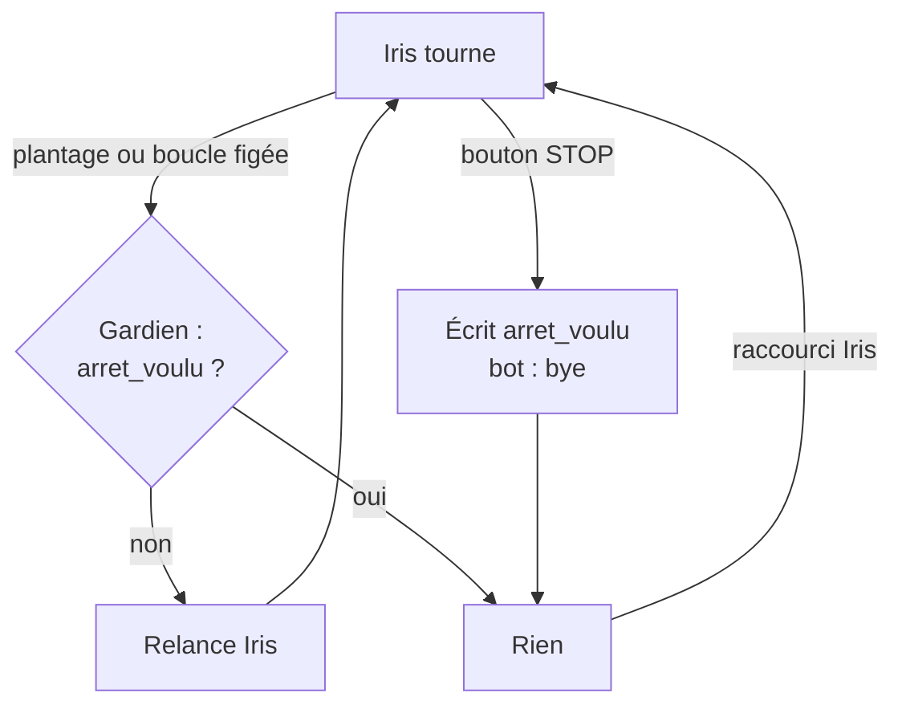
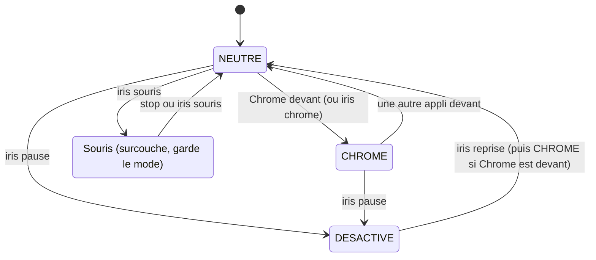

# 02 · Utilisation

> **En bref**
> Démarrer : raccourci « Iris » du bureau (ou démarrage de Windows, via le gardien).
> Arrêter : bouton STOP. Le gardien relance Iris après un plantage, jamais après un STOP.
> Au départ, Iris est en mode NEUTRE : la main ne fait rien, seule la voix agit.

## Démarrer

| Moyen | Ce qui se passe |
|---|---|
| Raccourci **« Iris »** du bureau | `tools/relancer.pyw` : tue l'Iris en cours (seulement `-m motionzero`, sans `/T`), efface `logs/arret_voulu`, lance Iris puis le gardien. |
| **Démarrage de Windows** | Raccourci « Iris (gardien) » du dossier Démarrage : `pythonw -m motionzero.garde --start`. |
| **Bot Discord** | Il relance Iris si elle se fige ou s'arrête sans dire « bye ». |
| Ligne de commande | `.venv/Scripts/python -m motionzero --voice` (`--simulation` : rien n'est envoyé à Windows). |
| Navigateur de « iris question » | une fois après l'installation : `.venv/Scripts/python -m playwright install chromium` (sans lui, Iris répond sans internet et le dit). |

## Page d'accueil

Un menu étroit à gauche mène à trois sections ; la dernière ouverte est gardée d'un démarrage à l'autre (`accueil_section.txt`). En bas du menu, **Fermer** (rouge).
- **Maintenant** : image de la caméra, dernières commandes, mots utiles ici, capteurs, consommation sur une ligne.
- **Réglages** : une carte par réglage, rangée par groupe (Entrées, Voix et sons, Dépannage). Un clic passe au choix suivant. Les réglages sont décrits dans `reglages.py` : en ajouter un = une entrée du registre, son texte et son effet dans la boucle principale.
- **Conso** : des graphes, un chiffre clé par carte : processeur et carte graphique (courbes Iris / PC sur la dernière minute), mémoire (barres, part d'Iris en vert), cœurs du processeur (une colonne chacun), fils les plus occupés ; état des modèles en haut. Rien n'est mesuré tant que la fenêtre est réduite ou cachée.

La croix de l'accueil ne ferme jamais Iris : la fenêtre se cache et l'icône d'Iris reste dans la zone de notification (en bas à droite, près de l'heure). Un clic sur l'icône ou « iris accueil » la rouvre. Seul le bouton **Fermer** du menu arrête Iris.

## Lecture à voix haute

Carte **Lecture à voix haute** (Réglages), **désactivée par défaut**. Activée : la voix de Windows lit les rappels, les messages Discord, les réponses de « iris question » et le résultat de « iris instruction » (faite, interrompue ou impossible) (« iris silence » / « iris lis » ne concernent que Discord). Désactivée : rien n'est lu, rappels compris, et la phrase en cours s'arrête. Choix gardé dans `lecture.txt`.

## Volume d'Iris

La carte **Volume d'Iris** de l'accueil règle les sons d'Iris seulement (pas le volume de Windows) : 30, 50, 70 puis 100 %. Un son est joué à chaque clic pour l'entendre. Choix gardé dans `volume_iris.txt`.

## Le bandeau en haut

À côté du logo, une seule île : en haut, un ou deux mots fixes, le mode (PAUSE…) ou, sinon, l'appli devant (CHROME, VS CODE, DISCORD…), puis l'état le plus important (AGRIPPE, puis SOURIS, CANDIDATURE, FOCUS, BYPASS). En dessous, dans la même île, une ligne courte et centrée : le dernier retour (commande comprise, « Écoute », « Main perdue »…), qui défile s'il est trop long et disparaît après 4 s ; au repos, elle liste les autres états allumés, pour qu'aucun ne soit caché. Rien à dire : le logo seul. Les rappels et les timers sonnent et s'affichent, sans être lus à voix haute.

## Effets d'animation

Si les « Effets d'animation » sont coupés dans Windows (Accessibilité > Effets visuels), l'île ne cligne plus, l'heure apparaît sans animation et l'alarme reste rouge sans pulser. Le réglage est lu au démarrage d'Iris.

## Voix basse

De 22 h à 7 h, Iris accepte une voix plus faible : la vérification qui écarte les mots de conversation devient moins stricte, mais les phrases longues restent refusées. La carte **Voix basse** de l'accueil passe de « le soir » à « toujours » puis « jamais ».

## Caméra

La carte **Caméra** de l'accueil rend la webcam aux autres applis (appel vidéo Discord : une webcam ne sert qu'à une appli à la fois). Les gestes sont en pause tant qu'elle est coupée ; le même bouton la reprend. Une relance d'Iris la rallume.

## Mode conversation

Carte **Mode conversation** de l'accueil, coché par défaut. Coché : un mot dit au milieu d'une conversation est ignoré (2e vérification par reconnaissance libre). Décoché : tout mot reconnu agit, sans cette vérification ; « iris » reste demandé là où il l'est. Choix gardé dans `conversation.txt`.

## Fermer Iris

Bouton **Fermer** du menu de l'accueil (rouge) : arrêt voulu, comme le STOP ; le gardien ne la relance pas.

## Arrêter

- **Bouton STOP** (en bas à droite) : un vrai clic seulement (souris, ou clic d'Iris en mode souris). Le survol ne l'active pas.
- STOP relâche tout, prévient le bot (`bye`) et écrit `logs/arret_voulu` : ni le gardien ni le bot ne relancent.
- Fermer le verre ou le bouton fait la même chose.
- Pour **relancer**, utiliser le raccourci « Iris » : il efface `arret_voulu`.

> **Note** « iris pause » n'arrête pas Iris : elle passe en mode DÉSACTIVÉ et reprend sur « iris ».

## Les modes

Le **mode** dit ce que fait la main. La **souris** n'est pas un mode : c'est un outil qui s'ajoute au mode en cours (on peut avoir Chrome + souris).

Le mode Chrome suit Chrome au premier plan (contrôlé toutes les 0,3 s), sans son à chaque Alt+Tab. Les fenêtres d'Iris (accueil, aide, fenêtre invisible des raccourcis Discord) ne comptent pas : « iris mute » ou « iris accueil » ne font plus quitter Chrome. « stop » ne quitte plus Chrome. Chaque changement de mode est noté dans le journal avec sa cause. La souris peut aussi s'allumer en CHROME : le mode reste.

| Mode | La main… | Particularités |
|---|---|---|
| **NEUTRE** | ne fait rien | mode de départ (`start_mode`) |
| **CHROME** | comme NEUTRE | mots de navigation sans « iris » (voir [commandes](03-commandes-vocales.md#mode-chrome)) ; actif tant que Chrome est au premier plan ; « iris chrome » le met devant (5 s pour s'ouvrir, sinon « CHROME INTROUVABLE ») |
| **DÉSACTIVÉ** | rien, MediaPipe arrêté | « iris » (et « stop ») réveille |

### La souris (surcouche)

- « iris souris » l'allume ou l'éteint. « stop » l'éteint sans changer de mode.
- Le curseur part du **centre**. Il attend que la main (ou la tête) passe au centre de l'image : c'est l'**armement**. Avant, une **main fantôme** montre où est la main.
- Main immobile 0,8 s : **menu à 4 directions** (gauche = clic gauche, droite = clic droit, haut = double clic, bas = souris éteinte).
- Clic par la main (si calibré, `calibration/poses.json`) : main fermée pour viser, rouverte = clic ; gardée ouverte plus de 2 s = bouton tenu.
- Pendant la souris : « clic », « double », « menu » marchent **sans « iris »**. Le clic vise là où était le curseur au début de la commande.

### Main ou tête

- « iris tête » / « iris main », ou la carte **Souris** de l'accueil. Le choix est gardé d'une session à l'autre (`pointeur.txt`).
- À la tête, seul le visage est détecté. « iris centre » : la tête de face devient le centre.

## Défilement

1. « iris scroll ».
2. Main : amène-la au **centre** (bande horizontale), la jauge à droite s'arme. Tête : armée tout de suite, le centre est la position de la tête à ce moment-là.
3. Monte la main (ou lève la tête) : ça monte. Descends-la : ça descend. Lent juste hors de la zone verte, de plus en plus vite vers les extrêmes (8 crans / s au plus à la main, 4 à la tête).
4. Fin : « iris scroll » redit, « stop », une autre commande, ou (à la main) main sortie de l'image.

## Dictée

| Commande | Où va le texte | Fin | Ensuite |
|---|---|---|---|
| « iris type » | là où est le curseur, n'importe quelle appli (Whisper) | 2 s de silence | 4 s après l'apparition du texte pour « envoie » (Entrée) ou « annule » (efface) ; ensuite « iris envoie », et « iris annule » efface encore la dictée seule |
| « iris claude » | micro de Claude dans VS Code | 2,75 s de silence | 30 s pour « envoie », « annule » ou « claude » (redicter) |
| « recherche » (mode Chrome) | barre d'adresse | comme « type » | idem |

Rien dit pendant 8 s : la dictée est abandonnée. Pendant une dictée, les mots ne sont **pas** des commandes.

---
[← Présentation](01-presentation.md) · [Sommaire](README.md) · [Commandes vocales →](03-commandes-vocales.md)

Si la caméra tombe en panne (image illisible, prise par une autre appli), une caméra barrée clignote en bas à gauche de l'écran, sans texte ; elle disparaît dès que l'image revient. Caméra coupée exprès (bouton de l'accueil) : rien ne s'affiche.
