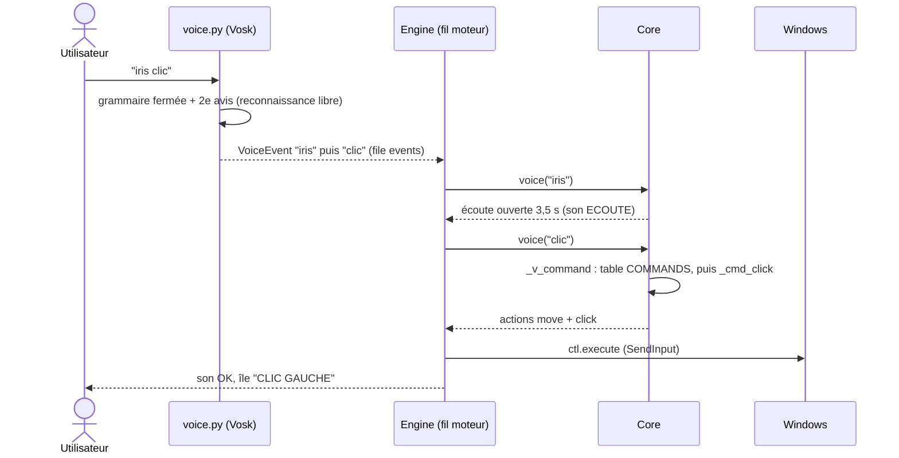
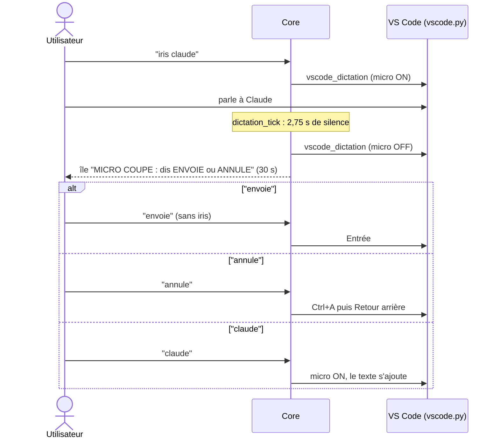
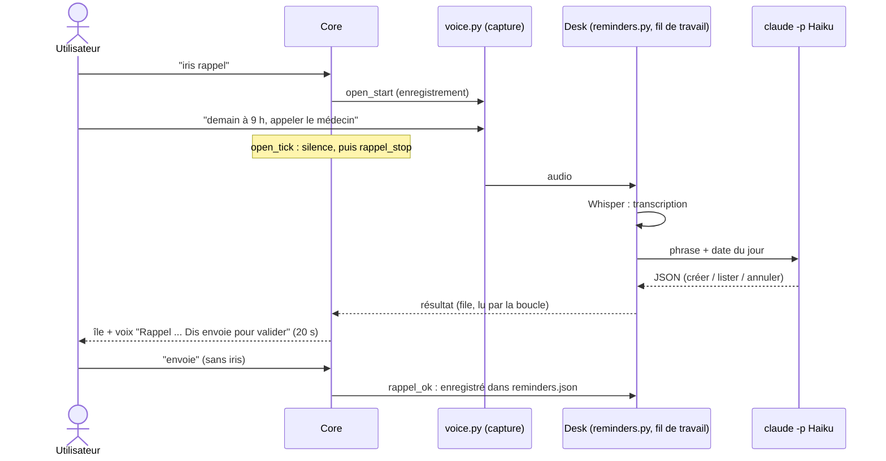

# 03 · Commandes vocales

> **En bref**
> Règle de base : dire « iris » puis **un** mot (d'un trait ou en deux temps, 3,5 s pour le mot).
> Quelques mots marchent sans « iris » selon le contexte : colonne « Sans iris ? ».
> Cette page est tirée des tables du code (`voice.WORDS`, `core.py`) : rien n'est inventé.

## Comment ça marche

- Une seule commande par « iris » : l'écoute se referme après.
- Un mot seul sans « iris » doit être net (confiance ≥ 0,8) et dit seul dans sa phrase.
- Mot entendu sans « iris » alors qu'il en faut un : l'île affiche « … ignore : dis IRIS avant ».
- Mots dits en deux morceaux, recollés : « des mute » = démute ; « plus tard » ; « plein écran » ; « double clic » = double.
- Synonymes (`ALIASES`) : envoyé = envoie ; muet = mute. (« ok », « okay », « wake » et « un mute » retirés le 14/11 : jamais utilisés, pris dans la conversation. « défun » retiré le 14/11 : « sourdine » seul.)
- Mots de la souris (`clic`, `double`, `menu`, `agrippe`) : écoutés seulement souris allumée (ou bouton tenu) et en mode Chrome. Ailleurs ils ne sont même pas cherchés : dis « iris souris » d'abord.

**Légende** — colonne « Sans iris ? » : « oui » marche toujours sans « iris » ; « répétable » : redit seul dans les 2 s après « iris + mot » ; « souris » : quand la souris est allumée ; « Chrome » : en mode Chrome ; « non » : il faut dire « iris » avant.
Mode : « tous » sauf mention.

## Sécurité et modes

| Mot | Effet | Sans iris ? | Mode |
|---|---|---|---|
| `iris` | ouvre l'écoute 3,5 s (en pause, il faut ensuite « reprise ») | — | tous |
| `stop` | relâche tout, coupe l'alarme ; finit le défilement, sinon éteint la souris, sinon LECTURE / CHROME → NEUTRE ; ferme le calendrier | oui | tous |
| `pause` | relâche tout, mode DÉSACTIVÉ (« iris reprise » pour revenir ; « iris » seul ne réactive plus) | non | tous |
| `lecture` | éteint la souris, mode LECTURE | non | tous |
| `souris` | allume / éteint la souris (le mode reste) | non | tous |
| `tête` / `main` | la souris suit la tête / la main | non | tous |
| `centre` | curseur au centre ; tête de face = nouvelle référence | non | tous |
| `aide` | toutes les commandes à l'écran, celles du mode en cours en tête ; « ferme », « merci » ou « stop » la ferment (sans « iris »), sinon seule après 90 s ; redit : fermée | « ferme » / « merci » quand elle est ouverte | tous |
| `guide` | ouvre cette documentation sur GitHub dans le navigateur | non | tous |

## Souris et clics

| Mot | Effet | Sans iris ? | Mode |
|---|---|---|---|
| `clic` | clic gauche, là où l'on visait au début de « iris » | souris Chrome | souris allumée, Chrome |
| `double` (ou « double clic ») | double clic | souris Chrome | souris allumée, Chrome |
| `menu` | clic droit | souris | souris allumée, Chrome |
| `agrippe` | enfonce le bouton gauche (glisser) et le tient sans limite (« AGRIPPE » dans l'îlot) ; redit, le relâche ; « stop » et la pause le relâchent aussi | oui pour relâcher, et en souris | souris allumée, Chrome |
| `scroll` | défilement à la main / tête ; redit = fin (ex-« défile », pris pour « défun ») | non | tous |

## Clavier et texte

| Mot | Effet | Sans iris ? | Mode |
|---|---|---|---|
| `entrée` | touche Entrée | non | tous |
| `envoie` (`envoyé`) | Entrée ; après une dictée : envoie le texte | oui après dictée / rappel | tous |
| `annule` | VS Code devant : vide le message de Claude ; sinon Échap. Après « iris type » : efface la dictée seule, même avec « iris » dans les 30 s (tant qu'aucune autre commande n'a suivi) | oui après dictée / rappel | tous |
| `space` | touche Espace (pause vidéo) | répétable Chrome | tous |
| `copie` / `colle` | Ctrl+C / Ctrl+V | non | tous |
| `sélection` | tout sélectionner (Ctrl+A) | non | tous |
| `coupe` | Ctrl+X | non | tous |
| `efface` | efface le mot d'avant (Ctrl+Retour arrière) | répétable | tous |
| `undo` / `redo` | annuler (Ctrl+Z) / rétablir (Ctrl+Y) ; « redo » est écouté comme « re do » | répétable | tous |
| `skip` / `back` | flèche droite / gauche (YouTube ±10 s) | répétable Chrome | tous |
| `type` | dictée Whisper écrite au curseur | non | tous |

## Fenêtres et applis

| Mot | Effet | Sans iris ? | Mode |
|---|---|---|---|
| `plein écran` | fenêtre active en plein écran (API Windows) | non | tous, Chrome compris |
| `agrandis` | plein écran | non | hors Chrome (en Chrome : zoom +) |
| `réduis` | fenêtre réduite (Win+Bas) | non | hors Chrome (en Chrome : zoom −) |
| `gauche` / `droite` | fenêtre ancrée à gauche / droite (Win+flèche) | non | tous |
| `tab` | fenêtre suivante (Alt+Tab) | non | tous |
| `suivant` / `précédent` | onglet suivant / précédent de VS Code (par exemple les onglets Claude), par l'extension « Iris (pont) » : commande de VS Code, pas de touche, marche où que soit le focus ; l'île dit « ECHEC » si l'onglet n'a pas changé. Sans l'extension : Ctrl+Page suivante / précédente, VS Code devant seulement. Installer : `tools/installer_pont.py` | oui VS Code devant ; répétable | hors Chrome (en Chrome : onglets de Chrome ; calendrier : semaine) |
| `chrome` | Chrome devant (ou lancé) + mode CHROME | non | tous |
| `discord` / `studio` / `accueil` | Discord / VS Code (sans micro) / fenêtre d'accueil d'Iris (le mode Chrome s'arrête quand Discord ou VS Code passe devant ; l'accueil ne le quitte pas) | non | tous |
| `ouvre` | **Depuis le 17/11, par « iris instruction » seulement** (plus guetté seul ; fait directement, sans `envoie`, si le plan ne contient que ces commandes) : « ouvre Spotify ». Ancien fonctionnement : puis le nom d'une appli (Whisper, menu Démarrer) | non | tous |
| `ferme` | retire la réponse affichée, puis écoute un nom d'appli à fermer | oui si quelque chose est affiché en haut | hors Chrome (en Chrome : ferme l'onglet) |
| `réveil` | rallume l'écran éteint | non | tous |
| `volume` | **Depuis le 17/11, par « iris instruction » seulement** (plus guetté seul ; fait directement, sans `envoie`, si le plan ne contient que ces commandes) : « volume à 40 ». Ancien fonctionnement : puis « 40 », « à fond », « plus fort », « coupe », « remets le son »… | non | tous |

## Claude

| Mot | Effet | Sans iris ? | Mode |
|---|---|---|---|
| `claude` | VS Code devant, micro de Claude allumé ; coupé après 2,75 s de silence | oui pour redicter, après une dictée | tous |
| `question` | question enregistrée, puis Whisper, puis Haiku ; si la réponse demande une info récente, recherche internet (Startpage, puis Bing) dans un navigateur sans fenêtre, puis réponse sourcée ; réponse dans l'île (« Iris cherche sur internet… » pendant la recherche) | non | tous |

## Discord

| Mot | Effet | Sans iris ? | Mode |
|---|---|---|---|
| `mute` | coupe le micro Discord | non | tous |
| `démute` (« des mute ») | rallume le micro | non | tous |
| `sourdine` | sourdine casque + micro | non | tous |
| `message` | **Depuis le 17/11, par « iris instruction » seulement** (plus guetté seul ; fait directement, sans `envoie`, si le plan ne contient que ces commandes) : « dis dans général que j'arrive ». Ancien fonctionnement : puis « dans général, … » : envoyé par le bot | non | tous |
| `salon` | **Depuis le 17/11, par « iris instruction » seulement** (plus guetté seul ; fait directement, sans `envoie`, si le plan ne contient que ces commandes) : « mets-moi dans le salon jeux ». Ancien fonctionnement : puis le nom d'un salon vocal : le bot t'y déplace | non | tous |
| `silence` / `lis` | coupe / remet la lecture à voix haute des messages | non | tous |
| `viens` / `pars` | le bot rejoint / quitte ton salon vocal | non | tous |

### Commandes écrites en MP au bot

Un MP au bot (de toi seul, propriétaire de l'application) est une commande d'Iris : `studio`, `iris studio`, `plein écran`… Le « iris » du début est facultatif. Le bot répond dans le MP :

- ce qu'Iris a affiché (« « studio » : VS CODE ») ;
- l'échec affiché dans l'île (appli introuvable, VS Code pas devant…) ;
- commande inconnue, avec des suggestions ;
- Iris pas joignable (arrêtée ou plantée) ou pas de réponse en 10 s (figée).

Les commandes suivies d'une phrase prennent la suite du MP à la place du micro (Whisper est sauté) : `ouvre spotify`, `timer 10 minutes`, `message dans général, salut`, `rappel dans 10 minutes, pâtes`, `question …`, `type …`, `volume 40`, `salon jeux`. `claude …` met VS Code devant et y tape le texte (puis `envoie` en MP). Seul `stop` est refusé : personne ne pourrait relancer Iris. Une commande écrite ne laisse pas l'écoute ouverte.

## Rappels, temps, calendrier

| Mot | Effet | Sans iris ? | Mode |
|---|---|---|---|
| `rappel` | **Depuis le 17/11, par « iris instruction » seulement** (plus guetté seul ; fait directement, sans `envoie`, si le plan ne contient que ces commandes) : « rappelle-moi demain à 9 h… ». Ancien fonctionnement : puis la demande : créer, lister, annuler (Whisper + Haiku). Depuis le 19/11 : une heure seule (« 17 h ») crée un rappel « Rappel » ; plusieurs rappels dans une phrase sont récapitulés puis validés ensemble (10 au plus) | non | tous |
| `merci` | retire ce qui est affiché en haut, valide le rappel ; ferme le calendrier | oui si quelque chose est affiché ou calendrier ouvert | tous |
| `plus tard` | le rappel affiché revient dans 10 min | oui rappel affiché | tous |
| `timer` | **Depuis le 17/11, par « iris instruction » seulement** (plus guetté seul ; fait directement, sans `envoie`, si le plan ne contient que ces commandes) : « timer de 10 minutes ». Ancien fonctionnement : puis la durée (« cinq minutes ») ; redit pendant qu'il tourne : annulé | non | tous |
| `chronomètre` | **Depuis le 17/11, par « iris instruction » seulement** (plus guetté seul ; fait directement, sans `envoie`, si le plan ne contient que ces commandes) : « lance le chronomètre ». Ancien fonctionnement : démarre ; redit : arrête | non | tous |
| `calendrier` | la semaine en 7 cartes (se ferme seul après 1 min) | non | tous |
| `heure` / `date` | jour, date et heure affichés 5 s | non | tous |
| `quota` | quota Claude : session de 5 h et semaine (pourcentage utilisé, heure du reset), logo Claude, collé au coin haut gauche, en permanence ; redire `quota` le masque (choix gardé au redémarrage) | non | tous |
| `traducteur` | sous-titres du son qui sort du PC (vidéo, appel…), traduits en anglais par Whisper (langue détectée seule), dans un bandeau en bas de l'écran que les clics traversent ; environ 3-5 s de retard ; redire `traducteur` l'éteint. Utilise le même Whisper que la voix : une commande dictée fait patienter les sous-titres | non | tous |
| `bypass` | reconnaissance permissive, pour les moments où tu ne parles pas à côté : une commande après « iris » acceptée dès 0,4 de certitude (au lieu de 0,6), un mot seul en focus dès 0,55 (au lieu de 0,8), sans 2e vérification. Jamais pour les mots définitifs (`ferme`, `envoie`, `envoyé`, `annule`, `efface`, `coupe`, `recharge`, `stop`, `agrippe`, `instruction`). S'ajoute au focus (« FOCUS · BYPASS ») ; redire `bypass` l'éteint, seul après 10 min sans commande | non | tous |
| `instruction` | puis une demande libre (« ouvre la dernière vidéo de One Click Studio ») : Whisper transcrit, un modèle local (Qwen3 4B via Ollama) en fait un plan avec les seuls outils d'Iris : applis (ouvrir, fermer, devant, à gauche / à droite), sites par leur nom (« ouvre mes mails », « ouvre leboncoin » : connus d'office, sinon cherchés sur internet puis retenus), recherches ciblées (Amazon, Maps, itinéraire, Wikipédia, Twitch, Spotify), YouTube (vidéo, dernière vidéo d'une chaîne, vidéo déjà vue dans l'historique), onglets de Chrome, commandes de la vidéo et de la musique, touches de navigation, texte, volume, Discord, timer, rappel, traducteur, météo, heure d'une ville, calcul, conversions, rappels à venir. Routines : « crée la routine mode travail : … » puis « lance la routine mode travail » ; « refais » rejoue la dernière instruction. Jamais : fichiers, arrêt de l'ordinateur, réglages (bloqué dans le code). Le plan s'affiche en haut ; `envoie` l'exécute, `annule` l'abandonne, sans réponse il est annulé au bout de 10 s ; `stop` l'arrête entre deux étapes. Rien n'est jamais fait sans `envoie`. « iris instruction » puis « aide » : carte d'exemples à dire | non | tous |
| `candidature` | Iris pilote CVGEN (le générateur de CV) par ses adresses locales, sans rien changer à CVGEN ni toucher aux sites d'emploi. Mode allumé, sans « iris » : `cherche` lance la recherche d'offres (redit : l'arrête), `état` affiche la recherche et le nombre d'offres à vérifier, `offres` ouvre la page des offres, `liste` affiche les offres une par une (à trier d'abord, puis à vérifier, meilleure note en tête : poste, entreprise, verdict, point fort, point faible), puis `suivante` / `précédente`, `garde` (CVGEN prépare son CV ; l'offre reste dans la liste, « CV en cours », jusqu'à ce qu'il soit prêt), `écarte`, `lien` (l'offre sur son site, comme un clic sur un lien), `prépare` (comme « Préparer la candidature » de CVGEN : CV composé, PDF du CV et des pièces ; l'avancement s'affiche sur la carte, une préparation à la fois ; si Iris redémarre pendant une préparation, le suivi reprend à l'ouverture du mode), `prépare tout` (prépare l'une après l'autre toutes les offres de la liste dont le CV est prêt), `montre` (le PDF du CV s'il est prêt, sinon l'atelier du CV, où la tête fait défiler), `relis` (la page de relecture par le jury), `aide` (toutes les commandes du mode, rangées par étape), `détails` (le début du texte de l'annonce dans le panneau, 40 s), `vérifie` (l'annonce est-elle encore en ligne), `annule` (remet la dernière offre gardée, écartée ou notée postulée dans son état d'avant, à sa place dans la liste ; une seule fois), `relances` (candidatures envoyées sans réponse, celles à relancer après 7 jours en tête). `suivante` sur la dernière offre annonce « fin de la liste » avant de revenir à la première. Postuler, sans rien d'automatisé sur le site : tu cliques dans un champ, puis `mail`, `téléphone`, `prénom`, `nom`, `ville`, `adresse`, `code postal`, `pays`, `naissance` (JJ/MM/AAAA), `disponibilité`, `salaire`, `permis`, `github`, `linkedin` y écrivent la valeur lue dans le profil de CVGEN (lu une fois par ouverture du mode, gardé en mémoire seulement ; absente du profil : rien n'est écrit ; si le navigateur n'est plus devant à l'arrivée de la réponse, rien n'est écrit et le panneau le dit) ; `tab` passe au champ suivant ; `question`, puis la question du formulaire dite à voix haute (transcrite par Whisper) : le modèle local de CVGEN propose une réponse courte, montrée dans le panneau (rien de privé ne lui est envoyé : ni adresse, ni téléphone, ni e-mail), et `écris` l'écrit dans le champ cliqué (navigateur devant seulement) ; `brouillon` (offre au CV prêt) cherche l'adresse e-mail dans l'annonce et ouvre dans ton logiciel de mail un brouillon avec le CV et la lettre en pièces jointes : tu relis et tu envoies toi-même ; `cv` / `lettre` écrivent le chemin du PDF dans la fenêtre « Choisir un fichier » de Windows et la valident (rien si cette fenêtre n'est pas devant) ; `postulé` note la candidature envoyée dans CVGEN (relance à J+7). Tant que le mode est allumé, un panneau à droite de l'écran (le site reste visible à gauche) montre l'état de la recherche, les chiffres (à trier, à vérifier, postulées, refusées), l'offre en cours (poste, entreprise, contrat, ville, télétravail, salaire, verdict, ancienneté, note, point fort et point faible), le retour de la dernière commande, les deux offres suivantes et, en bas, les quatre mots utiles à son étape avec ce que chacun fait, puis les autres mots de l'étape ; à l'ouverture du mode, la liste se charge et la première offre s'affiche. Si CVGEN est éteint, Iris le démarre sans fenêtre. Mode allumé, Iris n'écoute plus que ces mots, plus `stop` (toujours), `souris` (sans « iris ») et, souris allumée, ses mots (`clic`, `double`, `menu`, `agrippe`, `scroll`) : aucun autre mot de base ni de Chrome. Ces trois mots ne sont guettés que mode allumé ; redire `candidature` l'éteint (jamais tout seul), et la pause l'éteint. Voir `plan-cvgen.md` | non | tous |

Rien entendu, Haiku indisponible ou pas compris : l'île l'affiche et un son « NON » joue.

### Calendrier ouvert (sans « iris »)

| Mots | Effet |
|---|---|
| `suivant` / `précédent` | semaine (ou jour ouvert) suivante / précédente |
| `lundi` … `dimanche` | ce jour en grand |
| `aujourd'hui` | retour à aujourd'hui |
| `premier`, `deux` … `trente-et-un`, `deuxième` | la semaine de ce jour du mois |
| `janvier` … `décembre` | ce mois (seul ou après un jour) |
| `ferme`, `merci`, `stop` | ferme le calendrier |

Calendrier fermé, ces mots ne font rien (sans bruit).

## Mode Chrome

Ces mots ne sont écoutés **qu'en mode CHROME** (grammaire Vosk à part) et marchent **sans « iris »**. Ailleurs, « iris haut » répond « seulement en mode Chrome ».

| Mot | Touches | Effet |
|---|---|---|
| `retour` / `avance` | Alt+← / Alt+→ | page précédente / suivante |
| `suivant` / `précédent` | Ctrl+Tab / Ctrl+Maj+Tab | onglet suivant / précédent |
| `onglet` | Ctrl+T | nouvel onglet |
| `ferme` | Ctrl+W | ferme l'onglet ; si une réponse, un rappel, une liste ou l'heure est affiché en haut, il est d'abord retiré (redire `ferme` pour l'onglet) |
| `rouvre` | Ctrl+Maj+T | rouvre l'onglet fermé |
| `recharge` | F5 | recharge |
| `monte` / `descends` | Page haut / Page bas | une page |
| `agrandis` / `réduis` | Ctrl+plus / Ctrl+moins | zoom |
| `recherche` | Ctrl+L puis dictée | barre d'adresse |

Aussi sans « iris » en Chrome : `skip`, `back`, `space`, `clic`, `double`.

## Récapitulatif : mots sans « iris »

| Contexte | Mots |
|---|---|
| Toujours | `stop` ; `agrippe` pendant un glisser (relâche) |
| 2 s après « iris skip / back / efface / undo / redo / espace / suivant / précédent » | le même mot (et les autres touches répétables) ; chaque mot relance les 2 s |
| Souris allumée ou bouton tenu (« iris agrippe ») | `clic`, `double`, `menu`, `agrippe`, `scroll` |
| Mode focus (« iris focus ») | toutes les commandes, dites seules et nettement ; `focus` seul l'éteint. À garder pour les moments sans conversation à côté |
| VS Code devant (hors Chrome) | `suivant`, `précédent` |
| Réponse, rappel, liste ou heure affichés en haut | `ferme`, `merci` (le retirent) |
| Rappel affiché | `plus tard` |
| Mode CHROME | mots du tableau Chrome + `skip`, `back`, `space`, `clic`, `double` |
| Après « iris claude » (30 s) | `envoie`, `annule`, `claude` |
| Après « iris type » | `envoie`, `annule` : dès la coupure du micro, puis 4 s après l'apparition du texte. Juste après une dictée, ces deux mots sont reconnus plus facilement |
| Après la répétition d'un rappel (20 s) | `envoie`, `annule` |
| Calendrier ouvert | mots du calendrier, `ferme`, `merci`, `stop` |
| Bulle « SOURIS ? » ou menu de clic affichés | l'écoute est ouverte : tout mot de commande |

---
[← Utilisation](02-utilisation.md) · [Sommaire](README.md) · [Architecture →](04-architecture.md)
