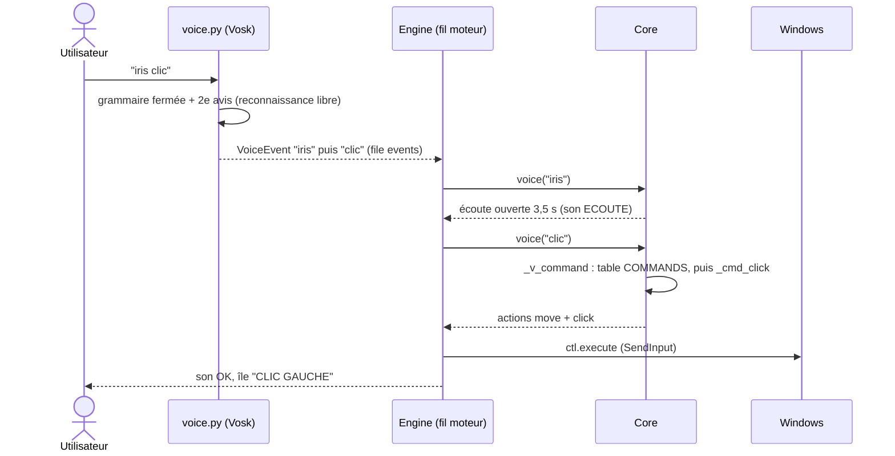
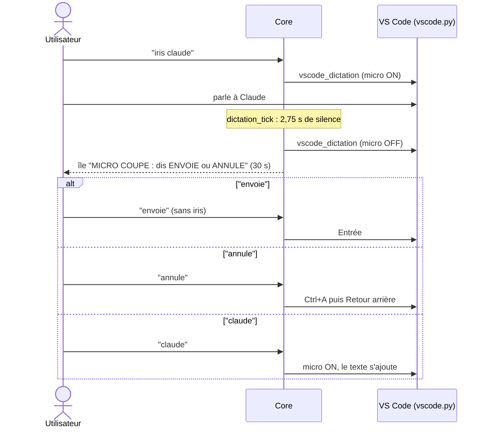
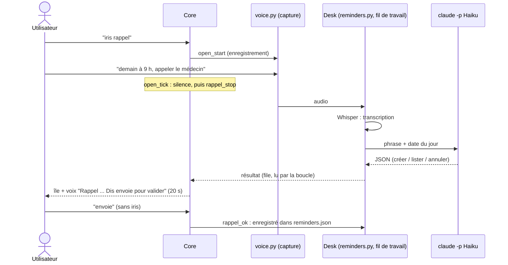

# 03 · Commandes vocales

> **En bref**
> Règle de base : dire « iris » puis **un** mot (d'un trait ou en deux temps, 3,5 s pour le mot).
> Quelques mots marchent sans « iris » selon le contexte : colonne « Sans iris ? ».
> Cette page est tirée des tables du code (`voice.WORDS`, `core.py`) : rien n'est inventé.

## 🔑 Comment ça marche

- Une seule commande par « iris » : l'écoute se referme après.
- Un mot seul sans « iris » doit être net (confiance ≥ 0,8) et dit seul dans sa phrase.
- Mot entendu sans « iris » alors qu'il en faut un : l'île affiche « … ignore : dis IRIS avant ».
- Mots dits en deux morceaux, recollés : « des mute » / « un mute » = démute ; « des fun » / « dis fun » = défun ; « plus tard » ; « plein écran » ; « double clic » = double.
- Synonymes (`ALIASES`) : envoyé = envoie ; muet = mute ; sourdine = défun ; ok / okay = merci.

**Légende** — Sans iris ? : ✅ toujours ; 🔁 répétable 2 s après « iris + mot » ; 🖱️ souris allumée ; 🌐 mode Chrome ; ❌ non.
Mode : « tous » sauf mention.

## 🛑 Sécurité et modes

| Mot | Effet | Sans iris ? | Mode |
|---|---|---|---|
| `iris` | ouvre l'écoute 3,5 s ; en DÉSACTIVÉ, repasse en NEUTRE | — | tous |
| `stop` | relâche tout, coupe l'alarme ; finit le défilement, sinon éteint la souris, sinon LECTURE / CHROME → NEUTRE ; ferme le calendrier | ✅ | tous |
| `pause` | relâche tout, mode DÉSACTIVÉ (« iris » pour reprendre) | ❌ | tous |
| `lecture` | éteint la souris, mode LECTURE | ❌ | tous |
| `souris` | allume / éteint la souris (le mode reste) | ❌ | tous |
| `tête` / `main` | la souris suit la tête / la main | ❌ | tous |
| `centre` | curseur au centre ; tête de face = nouvelle référence | ❌ | tous |

## 🖱️ Souris et clics

| Mot | Effet | Sans iris ? | Mode |
|---|---|---|---|
| `clic` | clic gauche, là où l'on visait au début de « iris » | 🖱️ 🌐 | tous |
| `double` (ou « double clic ») | double clic | 🖱️ 🌐 | tous |
| `menu` | clic droit | 🖱️ | tous |
| `glisse` | enfonce le bouton gauche (glisser) | ❌ | tous |
| `lâche` | relâche le bouton | ✅ si un glisser est en cours | tous |
| `défile` | défilement à la main / tête ; redit = fin | ❌ | tous |

## ⌨️ Clavier et texte

| Mot | Effet | Sans iris ? | Mode |
|---|---|---|---|
| `entrée` | touche Entrée | ❌ | tous |
| `envoie` (`envoyé`) | Entrée ; après une dictée : envoie le texte | ✅ après dictée / rappel | tous |
| `annule` | VS Code devant : vide le message de Claude ; sinon Échap. Après dictée : efface | ✅ après dictée / rappel | tous |
| `espace` / `space` | touche Espace (pause vidéo) | 🌐 | tous |
| `copie` / `colle` | Ctrl+C / Ctrl+V | ❌ | tous |
| `sélection` | tout sélectionner (Ctrl+A) | ❌ | tous |
| `coupe` | Ctrl+X | ❌ | tous |
| `efface` | efface le mot d'avant (Ctrl+Retour arrière) | 🔁 | tous |
| `skip` / `back` | flèche droite / gauche (YouTube ±10 s) | 🔁 🌐 | tous |
| `type` | dictée Whisper écrite au curseur | ❌ | tous |

## 🪟 Fenêtres et applis

| Mot | Effet | Sans iris ? | Mode |
|---|---|---|---|
| `plein écran` | fenêtre active en plein écran (API Windows) | ❌ | tous, Chrome compris |
| `agrandis` | plein écran | ❌ | hors Chrome (en Chrome : zoom +) |
| `réduis` | fenêtre réduite (Win+Bas) | ❌ | hors Chrome (en Chrome : zoom −) |
| `gauche` / `droite` | fenêtre ancrée à gauche / droite (Win+flèche) | ❌ | tous |
| `tab` | fenêtre suivante (Alt+Tab) | ❌ | tous |
| `chrome` | Chrome devant (ou lancé) + mode CHROME | ❌ | tous |
| `discord` / `studio` / `accueil` | Discord / VS Code (sans micro) / fenêtre d'accueil d'Iris ; quitte le mode CHROME | ❌ | tous |
| `ouvre` | puis le nom d'une appli (Whisper, menu Démarrer) | ❌ | tous |
| `ferme` | retire la réponse affichée, puis écoute un nom d'appli à fermer | ❌ | hors Chrome (en Chrome : ferme l'onglet) |
| `réveil` / `wake` | rallume l'écran éteint | ❌ | tous |
| `volume` | puis « 40 », « à fond », « plus fort », « coupe », « remets le son »… | ❌ | tous |

## 🤖 Claude

| Mot | Effet | Sans iris ? | Mode |
|---|---|---|---|
| `claude` | VS Code devant, micro de Claude allumé ; coupé après 2,75 s de silence | ✅ pour redicter, après une dictée | tous |
| `question` | question enregistrée, puis Whisper, puis Haiku ; réponse dans l'île | ❌ | tous |

## 💬 Discord

| Mot | Effet | Sans iris ? | Mode |
|---|---|---|---|
| `mute` (`muet`) | coupe le micro Discord | ❌ | tous |
| `démute` (« des mute », « un mute ») | rallume le micro | ❌ | tous |
| `défun` (« des fun », « dis fun », `sourdine`) | sourdine casque + micro | ❌ | tous |
| `message` | puis « dans général, … » : envoyé par le bot | ❌ | tous |
| `salon` | puis le nom d'un salon vocal : le bot t'y déplace | ❌ | tous |
| `silence` / `lis` | coupe / remet la lecture à voix haute des messages | ❌ | tous |
| `activation` | lance le bot vocal, charge Whisper | ❌ | tous |
| `viens` / `pars` | le bot rejoint / quitte ton salon vocal | ❌ | tous |

## ⏰ Rappels, temps, calendrier

| Mot | Effet | Sans iris ? | Mode |
|---|---|---|---|
| `rappel` | puis la demande : créer, lister, annuler (Whisper + Haiku) | ❌ | tous |
| `merci` (`ok`, `okay`) | retire ce qui est affiché en haut, valide le rappel ; ferme le calendrier | ✅ calendrier ouvert | tous |
| `plus tard` | le rappel affiché revient dans 10 min | ❌ | tous |
| `timer` | puis la durée (« cinq minutes ») ; redit pendant qu'il tourne : annulé | ❌ | tous |
| `chronomètre` | démarre ; redit : arrête | ❌ | tous |
| `calendrier` | la semaine en 7 cartes (se ferme seul après 1 min) | ❌ | tous |
| `heure` / `date` | jour, date et heure affichés 5 s | ❌ | tous |

Rien entendu, Haiku indisponible ou pas compris : l'île l'affiche et un son « NON » joue.

### 📅 Calendrier ouvert (sans « iris »)

| Mots | Effet |
|---|---|
| `suivant` / `précédent` | semaine (ou jour ouvert) suivante / précédente |
| `lundi` … `dimanche` | ce jour en grand |
| `aujourd'hui` | retour à aujourd'hui |
| `premier`, `deux` … `trente-et-un`, `deuxième` | la semaine de ce jour du mois |
| `janvier` … `décembre` | ce mois (seul ou après un jour) |
| `ferme`, `merci`, `stop` | ferme le calendrier |

Calendrier fermé, ces mots ne font rien (sans bruit).

## 🌐 Mode Chrome

Ces mots ne sont écoutés **qu'en mode CHROME** (grammaire Vosk à part) et marchent **sans « iris »**. Ailleurs, « iris haut » répond « seulement en mode Chrome ».

| Mot | Touches | Effet |
|---|---|---|
| `retour` / `avance` | Alt+← / Alt+→ | page précédente / suivante |
| `suivant` / `précédent` | Ctrl+Tab / Ctrl+Maj+Tab | onglet suivant / précédent |
| `onglet` | Ctrl+T | nouvel onglet |
| `ferme` | Ctrl+W | ferme l'onglet |
| `rouvre` | Ctrl+Maj+T | rouvre l'onglet fermé |
| `recharge` | F5 | recharge |
| `favori` | Ctrl+D | favori |
| `haut` / `bas` | Début / Fin | haut / bas de page |
| `monte` / `descends` | Page haut / Page bas | une page |
| `agrandis` / `réduis` | Ctrl+plus / Ctrl+moins | zoom |
| `recherche` | Ctrl+L puis dictée | barre d'adresse |

Aussi sans « iris » en Chrome : `skip`, `back`, `espace`, `space`, `clic`, `double`.

## ✅ Récapitulatif : mots sans « iris »

| Contexte | Mots |
|---|---|
| Toujours | `stop` ; `lâche` pendant un glisser |
| 2 s après « iris skip / back / efface » | `skip`, `back`, `efface` (chaque mot relance les 2 s) |
| Souris allumée | `clic`, `double`, `menu` |
| Mode CHROME | mots du tableau Chrome + `skip`, `back`, `espace`, `space`, `clic`, `double` |
| Après « iris claude » (30 s) | `envoie`, `annule`, `claude` |
| Après « iris type » (3 s) | `envoie`, `annule` |
| Après la répétition d'un rappel (20 s) | `envoie`, `annule` |
| Calendrier ouvert | mots du calendrier, `ferme`, `merci`, `stop` |
| Bulle « SOURIS ? » ou menu de clic affichés | l'écoute est ouverte : tout mot de commande |

---
[← Utilisation](02-utilisation.md) · [Sommaire](README.md) · [Architecture →](04-architecture.md)
