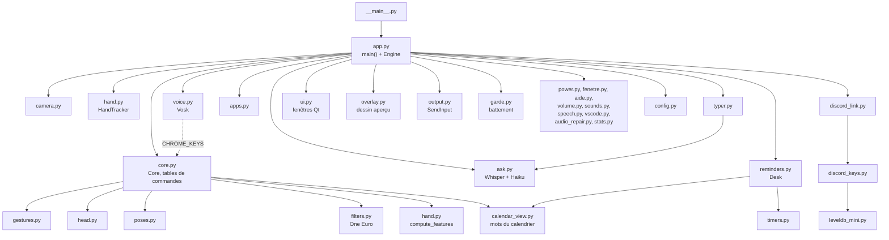
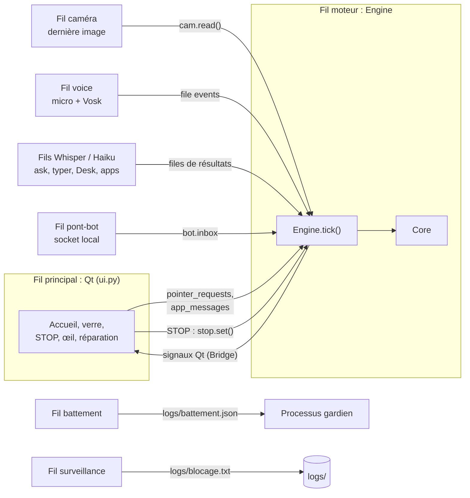
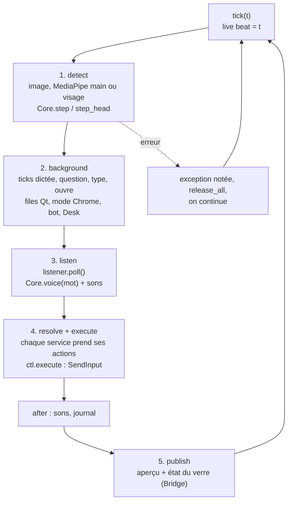
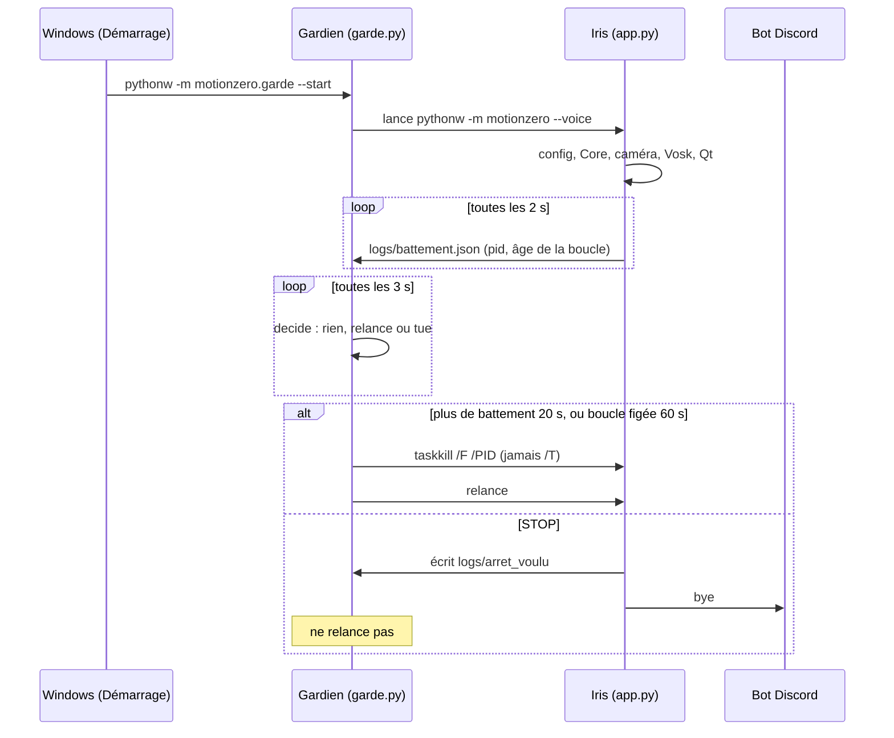

# 04 · Architecture

> **En bref**
> Un seul fil, « moteur », fait tourner la boucle `Engine` et possède `Core` (la machine à états).
> Tous les autres fils (micro, Whisper, bot, interface Qt) lui parlent par des **files** (`queue`).
> Règle d'or : **jamais modifier `Core` depuis un autre fil.**

## Modules et dépendances

> **Note** `core.py` ne dépend d'aucun service extérieur : il prend des points et des mots, il rend une liste d'**actions** (tuples comme `("click", "left")`). C'est ce qui le rend testable sans caméra.

## Fils d'exécution et files

| Fil | Rôle | Parle au moteur par |
|---|---|---|
| Qt (principal) | fenêtres, boutons | `pointer_requests`, `app_messages` ; reçoit `Bridge` (signaux) |
| `moteur` | `Engine.run()`, seul à toucher `Core` | — |
| caméra | lit la webcam, garde la dernière image | `cam.read(seq)` |
| `voice` | micro, Vosk, 2e avis, capture audio | `listener.events` (lu par `poll()`) |
| Whisper / Haiku | transcription, questions, rappels, applis | files internes de chaque service, lues dans la boucle |
| `pont-bot` | socket vers le bot Discord | `bot.inbox` (vidée par `bot_events`) |
| `battement` | écrit `battement.json` toutes les 2 s | lit `live["beat"]` |
| `surveillance` | boucle muette plus de 10 s : pile des fils dans `blocage.txt` | lit `live["beat"]` |

> **Note** Le lancement d'un travail lent (Whisper, Haiku, volume, réparation du son) se fait toujours dans un fil à part. La boucle ne fait jamais d'appel bloquant.

## La boucle `Engine` en 5 étapes

`Engine.tick()` (dans `app.py`) fait un tour : **détecter, fond, écouter, faire, montrer**.

- `resolve` enchaîne : `question_actions`, `type_actions`, `open_actions`, `desk.actions`, `discord_actions`, `power_actions`, `window_actions`, `vscode_actions`. Chacun **retire** les actions qu'il traite et rend le reste.
- La détection est plafonnée à 20 images/s, ralentie sans main, arrêtée en DÉSACTIVÉ.
- 20 erreurs en moins de 10 s : la boucle abandonne (le gardien relance).

## Cycle de vie

- **Démarrage** (`main()`) : journal tournant, config, `Core`, poses calibrées, caméra, MediaPipe, voix (si `--voice`), services, fenêtres Qt, puis les fils moteur, battement et surveillance.
- **Gardien** : 3 relances en 180 s au plus, sinon il abandonne (écrit dans `garde.log`). Il vérifie qu'aucune Iris ne tourne déjà (le bot relance aussi).
- **Arrêt** : `stop.set()`, tout relâché, `worker.join(3 s)`, puis `os._exit(0)` pour ne laisser aucun fil vivant.

---
[← Commandes vocales](03-commandes-vocales.md) · [Sommaire](README.md) · [Structure du projet →](05-structure-du-projet.md)
