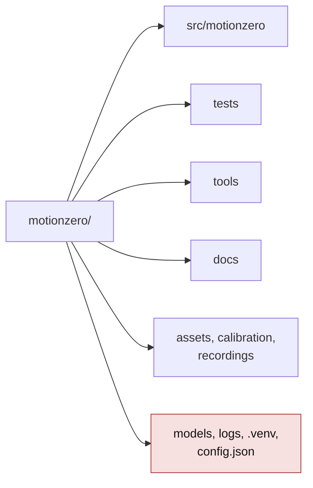

# 05 · Structure du projet

> **En bref**
> Le code est dans `src/motionzero/` (33 modules, environ 8 350 lignes). Les tests dans `tests/`, les outils dans `tools/`.
> `models/`, `logs/`, `.venv/` et `config.json` ne sont pas versionnés.
> Le tableau en bas dit, pour chaque module : son rôle, sa taille et ses tests.

## Arborescence

```text
motionzero/
├── CLAUDE.md                 consignes du projet
├── motionzero.md             besoins et décisions d'origine
├── plan-*.md                 plans (overlay, voix-claude, navigation-chrome, sons)
├── pyproject.toml            dépendances, pytest
├── pointeur.txt              dernier choix main / tête
├── reminders.json            rappels enregistrés
├── assets/                   sons, icônes, polices, images d'Iris
├── calibration/poses.json    repères des poses de la main (clic main ouverte)
├── docs/
│   ├── checkup-2026-11-13/   audit du 13/11
│   └── guide/                ce guide
├── recordings/               enregistrements de la main (.jsonl, sans image)
├── src/motionzero/           le code
├── tests/                    tests pytest (sans caméra)
├── tools/                    record, replay, relancer.pyw, calibration…
│
├── models/       (non versionné) modèles Vosk, MediaPipe, Whisper
├── logs/         (non versionné) motionzero.log, garde.log, battement.json, blocage.txt
├── .venv/        (non versionné) Python + DLL CUDA
└── config.json   (non versionné) réglages locaux
```



## Modules

| Module | Rôle | Lignes | Tests |
|---|---|---|---|
| `app.py` | `main()` : crée tout ; classe `Engine` (boucle) ; fonctions `*_actions` | 843 | test_engine, test_drain, test_mode_chrome, test_type, test_power, test_tete, test_discord_link, test_perf |
| `core.py` | machine à états ; `voice()` ; tables `COMMANDS`, `SIMPLE_ACTIONS`, `VOICE_HOTKEYS`, `CHROME_KEYS`, `ALIASES` | 1081 | test_voice, test_texte_fenetres, test_souris_*, test_dictation, test_mode_chrome, … |
| `voice.py` | Vosk, grammaire fermée, `WORDS`, 2e avis, capture audio | 436 | test_voice, test_sweep, test_dictation |
| `ui.py` | fenêtres Qt : accueil, verre, STOP, œil, réparation, île | 1475 | test_island, test_main_fantome, test_stats, … |
| `overlay.py` | dessin de l'aperçu caméra et de l'aide | 251 | test_sweep |
| `camera.py` | capture DirectShow MJPG, images corrompues jetées, reconnexion | 178 | test_camera_validation |
| `hand.py` | caractéristiques de la main, suivi des deux mains | 126 | test_engine, test_real_recording |
| `head.py` | souris à la tête (orientation du visage) | 116 | test_tete |
| `gestures.py` | immobilité, zones de bord, défilement, menu radial | 291 | test_real_recording |
| `poses.py` | poses par angles 3D des doigts (clic) | 128 | — |
| `filters.py` | filtre One Euro | 34 | test_engine |
| `output.py` | `SendInput`, relâchement de sécurité | 155 | test_engine, test_voice |
| `ask.py` | Whisper (GPU, déchargé après 10 min) + `claude -p` Haiku | 170 | test_perf |
| `typer.py` | « iris type » : écrit le texte dicté | 99 | test_type |
| `apps.py` | « iris ouvre / ferme » : applis du menu Démarrer | 246 | test_type |
| `reminders.py` | rappels, alarmes, `Desk` | 554 | test_reminders |
| `timers.py` | timer, chronomètre | 146 | test_timers |
| `calendar_view.py` | calendrier, mots du calendrier | 176 | test_calendar |
| `discord_link.py` | pont vers le bot Discord (socket local) | 235 | test_discord_link |
| `discord_keys.py` | raccourcis Discord lus sur le PC | 65 | test_discord_keys |
| `leveldb_mini.py` | lecteur LevelDB minimal | 130 | — (via test_discord_keys) |
| `vscode.py` | VS Code devant, micro de Claude | 246 | test_discord_keys |
| `speech.py` | lecture à voix haute (SAPI) | 78 | test_discord_link |
| `sounds.py` | sons d'Iris | 193 | test_sounds |
| `volume.py` | volume Windows à la voix | 157 | test_volume |
| `fenetre.py` | plein écran par l'API Windows ; « iris guide » (cette doc dans le navigateur) | 50 | test_texte_fenetres, test_aide |
| `aide.py` | contenu de « iris aide » : commandes par thème, bloc du mode en cours | 110 | test_aide |
| `power.py` | rallumer l'écran | 35 | test_power |
| `audio_repair.py` | redémarrer les services audio (bouton) | 61 | test_audio_repair |
| `garde.py` | battement, `arret_voulu`, gardien | 194 | test_garde |
| `config.py` | réglages, `config.json` | 200 | test_config_save |
| `stats.py` | consommation (page d'accueil) | 186 | test_stats |
| `replay.py` | lecture des enregistrements `.jsonl` | 28 | test_replay |
| `__main__.py` | `python -m motionzero` | 3 | — |

## Outils (`tools/`)

| Outil | Usage |
|---|---|
| `relancer.pyw` | raccourci « Iris » : arrête puis relance Iris et le gardien |
| `record.py` | enregistrer les points de la main : `python tools/record.py sortie.jsonl` |
| `replay.py` | rejouer et afficher les actions : `python tools/replay.py sortie.jsonl [config.json]` |
| `analyze.py` | analyse d'un enregistrement |
| `record_poses.py`, `calibrate_poses.py`, `pose_live.py` | calibrer les poses de la main |
| `voice_selftest.py` | test de la voix |
| `prepare_logos.py`, `test_sendinput.py` | utilitaires |

---
[← Architecture](04-architecture.md) · [Sommaire](README.md) · [Développement →](06-developpement.md)
