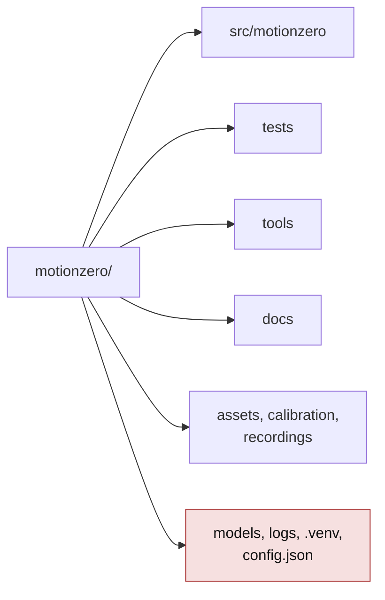

# 05 · Structure du projet

> **En bref**
> Le code est dans `src/motionzero/` (33 modules, environ 8 350 lignes). Les tests dans `tests/`, les outils dans `tools/`.
> `models/`, `logs/`, `.venv/` et `config.json` ne sont pas versionnés.
> Le tableau en bas dit, pour chaque module : son rôle, sa taille et ses tests.

## Arborescence

```text
motionzero/
├── CLAUDE.md                 consignes du projet
├── motionzero.md             besoins et décisions d'origine
├── plan-*.md                 plans (overlay, voix-claude, navigation-chrome, sons)
├── pyproject.toml            dépendances, pytest
├── pointeur.txt              dernier choix main / tête
├── reminders.json            rappels enregistrés
├── assets/                   sons, icônes, polices, images d'Iris
├── calibration/poses.json    repères des poses de la main (clic main ouverte)
├── docs/
│   ├── checkup-2026-11-13/   audit du 13/11
│   └── guide/                ce guide
├── recordings/               enregistrements de la main (.jsonl, sans image)
├── src/motionzero/           le code
├── tests/                    tests pytest (sans caméra)
├── tools/                    record, replay, relancer.pyw, calibration…
│
├── models/       (non versionné) modèles Vosk, MediaPipe, Whisper
├── logs/         (non versionné) motionzero.log, garde.log, battement.json, blocage.txt
├── .venv/        (non versionné) Python + DLL CUDA
└── config.json   (non versionné) réglages locaux
```



## Modules

> **Découpage (#52, 25/11)** : aucun fichier de `src/motionzero` ne dépasse 400 lignes (300 visés). Un gros module garde son nom et réexporte tout (les `from .x import y` restent valables) ; son contenu vit dans des fichiers voisins :
> - `x_base.py`, `x_base2.py` : constantes et fonctions pures du module `x` ;
> - classes partielles (mixins) dont hérite la classe principale : `Core` = `core_main` (main, souris) + `core_defilement` + `core_voix` + `core_commandes` + `core_ecoute`, constantes dans `core_mots` ; `Engine` (`app.py`) = `app_detection` + `app_ecoute` + `app_affichage`, `main()` dans `app_main` ; l'île (`ui_ile.py`) = `ui_ile_panneau` + `ui_ile_cartes` + `ui_ile_calendrier` + `ui_ile_pieces` ; `Candidature` (`cvgen.py`) = `cvgen_fil` + `cvgen_evenements` + `cvgen_commandes` ; `Instructeur` = `instruction_outils`.
> - Un test qui remplace une fonction (`monkeypatch`) vise le fichier où elle vit vraiment, pas le module qui la réexporte.
> Les nombres de lignes ci-dessous datent d'avant ce découpage.

| Module | Rôle | Lignes | Tests |
|---|---|---|---|
| `app.py` | `main()` : crée tout ; classe `Engine` (boucle) | 806 | test_engine, test_drain, test_perf, … |
| `app_actions.py` | fonctions `*_actions` : question, ouvre / ferme, Discord, dictée, VS Code et Chrome | 345 | test_mode_chrome, test_type, test_discord_link, … |
| `app_outils.py` | fonctions pures et petits fichiers de réglages (volume, voix basse, pointeur…) | 230 | test_petites_issues, test_voix_basse, test_audit |
| `core.py` | machine à états : `Core` (main, souris, défilement, appli devant) ; hérite des trois suivants | 622 | test_voice, test_souris_*, test_mode_chrome, … |
| `core_mots.py` | constantes de `Core` : `Mode`, tables `COMMANDS`, `SIMPLE_ACTIONS`, `VOICE_HOTKEYS`, `CHROME_KEYS`, `ALIASES`, délais | 130 | test_voice, test_outils |
| `core_voix.py` | `voice()` et l'aiguillage des mots (confirmation, calendrier, aide, stop, candidature, sans « iris ») | 334 | test_voice, test_dictation, test_cvgen |
| `core_commandes.py` | commandes « iris + mot » (`_cmd_*`) | 168 | test_voice, test_bypass, … |
| `core_ecoute.py` | écoutes en cours : dictée Claude, question, frappe, phrase libre, confirmations | 171 | test_dictation, test_type, test_cvgen |
| `voice.py` | Vosk, grammaire fermée, `WORDS`, 2e avis, capture audio | 436 | test_voice, test_sweep, test_dictation |
| `ui.py` | `Bridge` (signaux moteur -> Qt) ; réexporte les trois suivants | 41 | — |
| `ui_ile.py` | île en haut, panneau candidature, calendrier, aide, rappels, sous-titres, volume ; calculs purs | 1380 | test_island, test_cvgen, test_stats, … |
| `ui_accueil_fen.py` | page d'accueil, menu latéral : Maintenant, Réglages, Conso | 288 | test_accueil, test_reglages |
| `ui_accueil_pages.py` | cartes de réglage, menu | 268 | test_reglages |
| `ui_accueil_conso.py` | section Consommation : graphes processeur, carte graphique, mémoire, cœurs, fils | 250 | test_reglages |
| `reglages.py` | registre des réglages de l'accueil (sans Qt) | 104 | test_reglages |
| `ui_verre.py` | verre plein écran, boutons STOP / œil / réparer, capteur de touches | 480 | test_main_fantome |
| `overlay.py` | dessin de l'aperçu caméra et de l'aide | 251 | test_sweep |
| `camera.py` | capture DirectShow MJPG, images corrompues jetées, reconnexion | 178 | test_camera_validation |
| `hand.py` | caractéristiques de la main, suivi des deux mains | 126 | test_engine, test_real_recording |
| `head.py` | souris à la tête (orientation du visage) | 116 | test_tete |
| `gestures.py` | immobilité, zones de bord, défilement, menu radial | 291 | test_real_recording |
| `poses.py` | poses par angles 3D des doigts (clic) | 128 | — |
| `filters.py` | filtre One Euro | 34 | test_engine |
| `output.py` | `SendInput`, relâchement de sécurité | 155 | test_engine, test_voice |
| `ask.py` | Whisper (GPU, déchargé après 10 min) + `claude -p` Haiku ; demande une recherche si besoin (2 appels au plus) | 230 | test_perf, test_question_web |
| `web.py` | recherche internet : Chromium headless (Playwright), Startpage puis Bing, texte des 2 premières pages (12 000 car. au plus) | 120 | test_question_web |
| `typer.py` | « iris type » : écrit le texte dicté | 99 | test_type |
| `traducteur.py` | « iris traducteur » : son du PC (WASAPI loopback) coupé aux silences, traduit en anglais par le Whisper d'`ask.py`, sous-titres en bas d'écran | 180 | test_traducteur |
| `instruction.py` | « iris instruction » : phrase -> modèle local (Ollama, catalogue d'outils fermé) -> plan vérifié, affiché, exécuté après « envoie » ; YouTube résolu sans clic | 330 | test_instruction |
| `cvgen.py` | « iris candidature » : Iris pilote CVGEN par ses adresses existantes (recherche, état, page des offres), le démarre s'il est éteint ; fil + queue | 190 | test_cvgen |
| `outils.py` | outils d'« iris instruction » : routines et favoris (routines.json, favoris.json), recherches ciblées, onglets par leur titre, historique de Chrome en lecture seule (copie), fenêtres, touches multimédia, météo (Open-Meteo), heure, calcul sûr, conversions | 330 | test_outils |
| `apps.py` | « iris ouvre / ferme » : applis du menu Démarrer | 246 | test_type |
| `reminders.py` | rappels, alarmes, `Desk` | 554 | test_reminders |
| `timers.py` | timer, chronomètre | 146 | test_timers |
| `calendar_view.py` | calendrier, mots du calendrier | 176 | test_calendar |
| `discord_link.py` | pont vers le bot Discord (socket local) | 235 | test_discord_link |
| `discord_cmd.py` | commandes d'Iris écrites en MP au bot (#43) | 70 | test_discord_cmd |
| `discord_keys.py` | raccourcis Discord lus sur le PC | 65 | test_discord_keys |
| `leveldb_mini.py` | lecteur LevelDB minimal | 130 | — (via test_discord_keys) |
| `vscode.py` | VS Code devant, micro de Claude | 246 | test_discord_keys |
| `speech.py` | lecture à voix haute (SAPI) | 78 | test_discord_link |
| `sounds.py` | sons d'Iris | 193 | test_sounds |
| `volume.py` | volume Windows à la voix | 157 | test_volume |
| `fenetre.py` | plein écran par l'API Windows ; « iris guide » (cette doc dans le navigateur) | 50 | test_texte_fenetres, test_aide |
| `aide.py` | contenu de « iris aide » : commandes par thème, bloc du mode en cours | 110 | test_aide |
| `power.py` | rallumer l'écran | 35 | test_power |
| `audio_repair.py` | redémarrer les services audio (bouton) | 61 | test_audio_repair |
| `garde.py` | battement, `arret_voulu`, gardien | 194 | test_garde |
| `config.py` | réglages, `config.json` | 200 | test_config_save |
| `stats.py` | consommation (page d'accueil) | 186 | test_stats |
| `replay.py` | lecture des enregistrements `.jsonl` | 28 | test_replay |
| `__main__.py` | `python -m motionzero` | 3 | — |

## Outils (`tools/`)

| Outil | Usage |
|---|---|
| `relancer.pyw` | raccourci « Iris » : arrête puis relance Iris et le gardien |
| `record.py` | enregistrer les points de la main : `python tools/record.py sortie.jsonl` |
| `replay.py` | rejouer et afficher les actions : `python tools/replay.py sortie.jsonl [config.json]` |
| `analyze.py` | analyse d'un enregistrement |
| `record_poses.py`, `calibrate_poses.py`, `pose_live.py` | calibrer les poses de la main |
| `voice_selftest.py` | test de la voix |
| `prepare_logos.py`, `test_sendinput.py` | utilitaires |

---
[← Architecture](04-architecture.md) · [Sommaire](README.md) · [Développement →](06-developpement.md)
