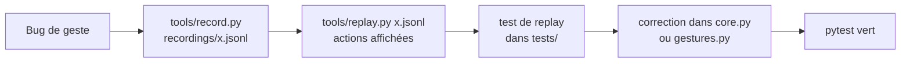
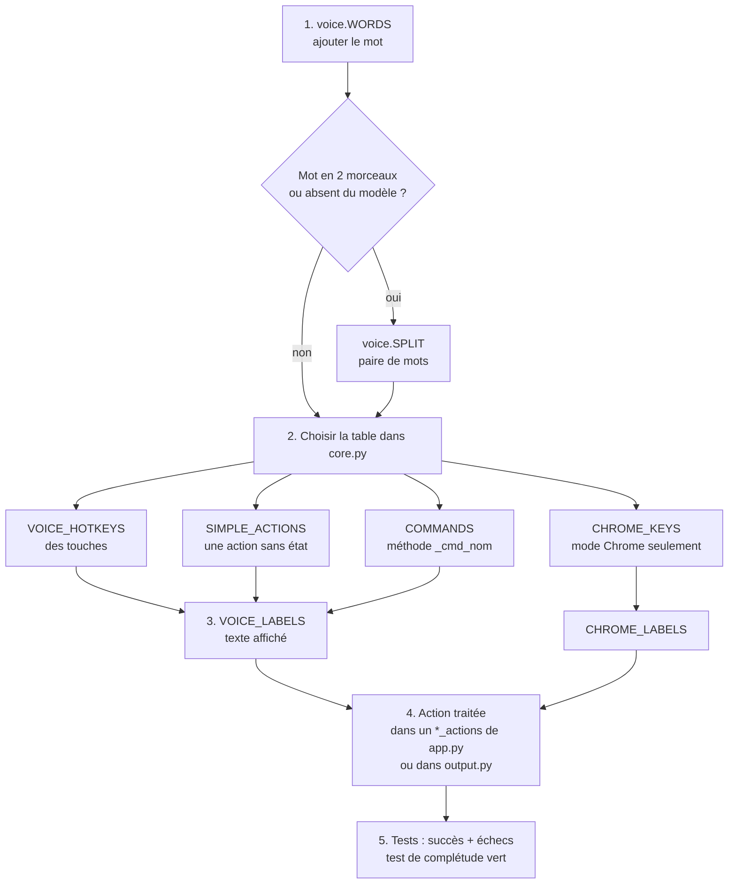

# 06 · Développement

> **En bref**
> Tests : `.venv/Scripts/python -m pytest -q` (environ 11 s, sans caméra).
> Un bug de geste = un enregistrement + un test de replay. Chaque fonction : tester aussi les échecs.
> Git : une branche temporaire depuis `dev`, fusion après validation de l'utilisateur.

## Tests

```bash
.venv/Scripts/python -m pytest -q
```

- Tout passe sans caméra ni micro : `Core` reçoit des points et des mots, il rend des actions.
- `test_real_recording` se saute si `recordings/essai1.jsonl` manque.
- `tests/synth.py` fabrique des mains de synthèse.
- Un hook `Stop` relance les tests si du Python a changé : on ne dit pas « terminé » tant qu'ils échouent.

## Enregistrer et rejouer un geste



Un enregistrement contient une ligne par image : `{"t": secondes, "pts": [[x, y] x 21] ou null}`. Aucune image.

## Règles Git et du projet

| Règle | Détail |
|---|---|
| Branches | une branche temporaire depuis `dev`, une seule à la fois |
| Fusion | dans `dev` seulement après validation de l'utilisateur, puis supprimer la branche (locale + GitHub) |
| Commits | en français, courts, sans mention de Claude (pas de Co-Authored-By) |
| Reports | tout point reporté = une issue GitHub |
| Fils | jamais modifier `Core` depuis un autre fil : passer par une file lue dans la boucle |
| Échecs | tester rien entendu, nom inconnu, exception d'un service |
| Relance | Iris arrêtée (STOP, fin de test) : la relancer tout de suite |

## Ajouter une commande vocale, pas à pas



1. **Grammaire Vosk** : ajouter le mot à `voice.WORDS` (mot → prononciation). La grammaire (`GRAMMAR`, `GRAMMARS`) en est tirée. Un mot que le modèle ne connaît pas s'écoute en deux morceaux via `SPLIT` (exemple : `("des", "mute"): "démute"`).
2. **Table de `core.py`** :
   - `VOICE_HOTKEYS` : le mot envoie des touches (`"coupe": ["ctrl", "x"]`).
   - `SIMPLE_ACTIONS` : une action sans état et son libellé (`"réveil": (("wake",), "ECRAN RALLUME")`).
   - `COMMANDS` : le mot appelle `Core._cmd_<nom>(word, t, acts)`, qui ajoute ses actions et renvoie un libellé ou `None`.
   - `CHROME_KEYS` (+ `CHROME_LABELS`) : seulement en mode Chrome, sans « iris ».
   - `ALIASES` : un synonyme d'un mot existant.
   - `REPEATABLE` : redit sans « iris » pendant 2 s.
3. **Libellé** dans `VOICE_LABELS` (affiché dans l'île).
4. **Effet** : une nouvelle action (tuple) doit être prise par une fonction `*_actions` de `app.py` (ou `Desk.actions`, `power_actions`, `window_actions`) ou par `output.Controller`.
5. **Tests** : `tests/test_texte_fenetres.py::test_chaque_mot_ecoute_a_un_traitement` échoue si un mot de `WORDS` n'est dans aucune table, ou si une méthode `_cmd_` manque. Ajouter un test du cas normal et des échecs.

> **Note** Vérifier les conflits : un mot déjà utilisé ailleurs (Chrome, calendrier) ne doit changer que là où il y a conflit. Tester tous les usages du mot.

## Pièges

| Piège | Ce qu'il faut savoir |
|---|---|
| Whisper GPU | tourne via les DLL `nvidia-cublas-cu12` / `nvidia-cudnn-cu12` du venv ; chargé seulement avec `--voice`, déchargé après 10 min d'inactivité (2-3 s pour le recharger) |
| `taskkill /T` | **jamais** : il tue aussi les applis ouvertes par Iris (Chrome) et le bot Discord. Toujours `taskkill /F /PID` sur le processus `-m motionzero` |
| Deux instances | arrêter l'ancienne avant de relancer (le raccourci « Iris » le fait) |
| Gardien | après un arrêt pour test, `arret_voulu` empêche la relance : relancer par `tools/relancer.pyw` |
| Touches simulées pour Claude Code | non : voir `plan-voix-claude.md` (commande cachée de l'extension et raccourci dédié) |
| Réglages Windows | ne jamais changer veille ou alimentation sans accord |
| `config.json` | non versionné ; les clés ont les mêmes noms que la classe `Config` |

---
[← Structure du projet](05-structure-du-projet.md) · [Sommaire](README.md) · [Dépannage →](07-depannage.md)
