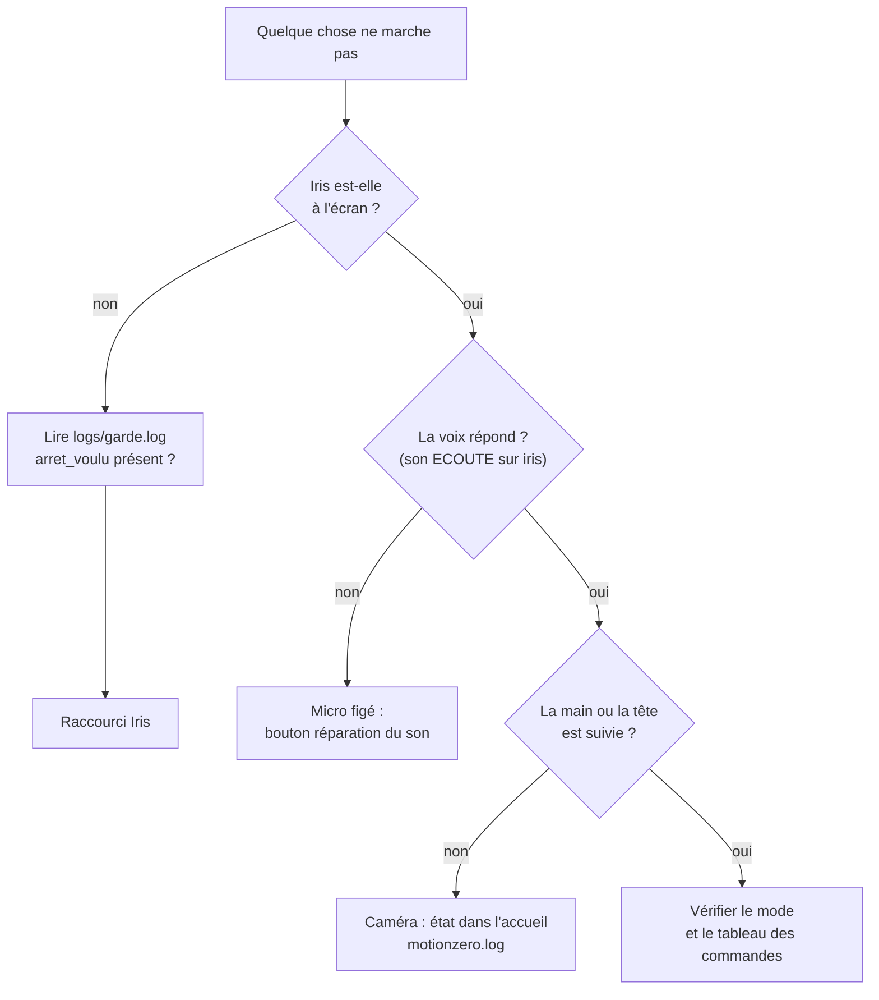
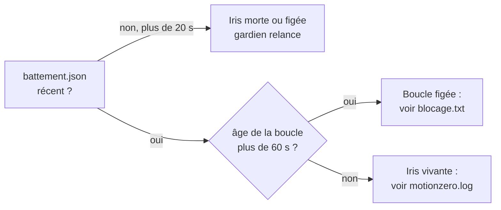

# 07 · Dépannage

> **En bref**
> Cherche ton symptôme dans le tableau, puis applique la solution.
> Les journaux sont dans `logs/` : `motionzero.log` d'abord, `garde.log` si Iris ne revient pas.
> En dernier recours : raccourci « Iris » du bureau (il arrête et relance tout proprement).

## Par où commencer

## Symptôme → cause → solution

| Symptôme | Cause probable | Solution |
|---|---|---|
| « iris » ne fait plus rien, aucun son | micro figé par le moteur audio de Windows (`audiodg.exe`) | bouton **réparation du son** (en bas à gauche) : redémarre les services audio ; Windows demande « Oui / Non » (droits administrateur) |
| Le mot est affiché « ignore : dis IRIS avant » | mot dit sans « iris » | redire avec « iris » ; voir [mots sans iris](03-commandes-vocales.md#mots-sans-iris) |
| « HAUT : seulement en mode Chrome » | mot de Chrome hors mode Chrome | « iris chrome » d'abord |
| Rien ne se passe sur la main | mode NEUTRE ou DÉSACTIVÉ | « iris lecture » ou « iris souris » ; en pause : « iris » |
| Le curseur ne bouge pas en souris | souris pas encore **armée** | amener la main (ou la tête) au centre : suivre la main fantôme |
| Défilement inerte | pas armé | main au centre de l'image, la jauge s'arme |
| Image grisée, état « perdue » | caméra muette (débranchée, prise par une autre appli) | Iris relâche tout et se reconnecte seule ; sinon débrancher / rebrancher, puis raccourci « Iris » |
| « RIEN ENTENDU » après type / ouvre / rappel | rien dit en 5 à 8 s, ou silence trop tôt | recommencer et parler tout de suite après le son |
| « Haiku indisponible » | `claude` absent, pas de réseau, quota | réessayer plus tard ; le reste d'Iris marche |
| Première dictée lente | Whisper déchargé après 10 min | normal : 2-3 s de rechargement |
| Iris ne se relance pas après un plantage | `logs/arret_voulu` existe (STOP), ou 3 relances en 3 min (gardien abandonné) | lire `garde.log` ; raccourci « Iris » (efface `arret_voulu`, relance le gardien) |
| Deux Iris en même temps | lancée deux fois à la main | raccourci « Iris » (tue les `-m motionzero`, jamais `/T`) |
| Chrome ou le bot fermés avec Iris | `taskkill /T` utilisé | ne jamais utiliser `/T` |
| Overlay visible dans un partage d'écran | réglage par défaut | bouton **œil** à côté de STOP |
| Commande Discord sans effet | bot non lancé ou non connecté | « iris activation » ; Iris relance le bot au plus une fois par minute |

## Les fichiers de `logs/`

| Fichier | Écrit par | Contenu | Quand le lire |
|---|---|---|---|
| `motionzero.log` (+ `.1`…`.3`) | Iris | modes, mots entendus (« acceptee » / « ignoree »), touches, erreurs avec leur pile ; tourne à 3 × 2 Mo | toujours en premier |
| `garde.log` | gardien | démarrage, « Iris absente sans arret voulu : relance », « Iris figee », abandon après 3 relances | Iris ne revient pas |
| `blocage.txt` | fil surveillance | pile de tous les fils quand la boucle est muette plus de 10 s | Iris figée, ou relancée pour « figée » |
| `battement.json` | fil battement (toutes les 2 s) | `pid`, heure, âge de la boucle principale | vérifier qu'Iris vit : heure récente, âge petit |
| `arret_voulu` | bouton STOP | présence = arrêt voulu, pas de relance | Iris ne se relance pas |

> **Note** Une erreur dans un tour de boucle n'arrête pas Iris : elle est notée dans `motionzero.log` (« erreur dans la boucle principale (on continue) »), tout est relâché, et la boucle continue.

---
[← Développement](06-developpement.md) · [Sommaire](README.md) · [Retour au début →](README.md)
