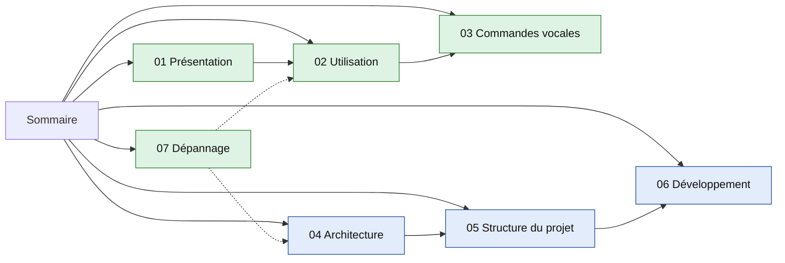

# Guide d'Iris (motionzero)

> **En bref**
> Iris pilote Windows sans les mains : gestes devant la webcam et commandes vocales « iris + mot ».
> Ce guide a 7 pages : utilisation, commandes, architecture, code, développement, dépannage.
> Commence par la ligne « je veux… » qui te concerne.

## Carte des pages

Vert : pour l'utilisateur. Bleu : pour le développeur.

## Je veux…

| Je veux… | Va à… |
|---|---|
| comprendre ce que fait Iris | [01 Présentation](01-presentation.md) |
| démarrer, arrêter, changer de mode | [02 Utilisation](02-utilisation.md) |
| défiler une page, dicter du texte | [02 Utilisation](02-utilisation.md#défilement) |
| trouver le mot à dire | [03 Commandes vocales](03-commandes-vocales.md) |
| savoir quels mots marchent sans « iris » | [03 Commandes vocales](03-commandes-vocales.md#mots-sans-iris) |
| comprendre les fils et la boucle principale | [04 Architecture](04-architecture.md) |
| savoir quel fichier fait quoi | [05 Structure du projet](05-structure-du-projet.md) |
| lancer les tests, ajouter une commande vocale | [06 Développement](06-developpement.md) |
| réparer : micro figé, caméra perdue, Iris arrêtée | [07 Dépannage](07-depannage.md) |

## Les pages

1. [Présentation](01-presentation.md) : à quoi sert Iris, schéma d'ensemble.
2. [Utilisation](02-utilisation.md) : démarrer, arrêter, modes, défilement, dictée.
3. [Commandes vocales](03-commandes-vocales.md) : tous les mots, par thème.
4. [Architecture](04-architecture.md) : modules, fils, boucle `Engine`, cycle de vie.
5. [Structure du projet](05-structure-du-projet.md) : arborescence et rôle de chaque module.
6. [Développement](06-developpement.md) : tests, replay, Git, pièges.
7. [Dépannage](07-depannage.md) : symptôme, cause, solution.

> **Note** Ce guide décrit le code de la branche `dev` au 13/11/2026. Les autres documents du dépôt : `motionzero.md` (décisions d'origine), `plan-*.md` (plans), `docs/checkup-2026-11-13/` (audit).

---
[Présentation →](01-presentation.md)
